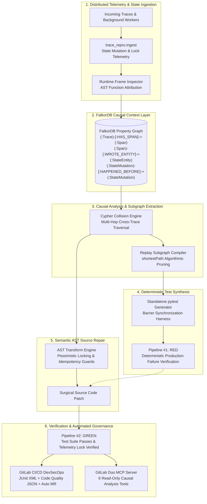
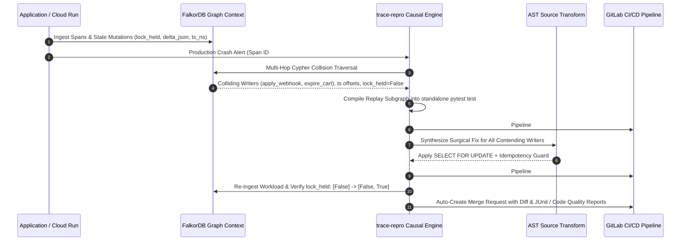

# trace-repro
**Autonomous Cross-Trace Bug Reproducer & Causal Self-Healing Engine.**

[](https://gitlab.com/gitlab-ai-hackathon/transcend-october-2026/43388957/showcase/-/pipelines)
[](https://falkordb.com)
[](https://about.gitlab.com/solutions/ai/)
[](tests/)
[](https://cloud.google.com/run)
[](LICENSE)
[](pyproject.toml)

---

## 📺 Production Demo Video

**[▶ Watch the 3-Minute Production Demo on YouTube (https://youtu.be/-uoCZpG7Rfk)](https://youtu.be/-uoCZpG7Rfk)**

[](https://youtu.be/-uoCZpG7Rfk)

*Watch `trace-repro` detect a live cross-trace race on Google Cloud Run, query the FalkorDB causal context layer, synthesize a deterministic failing test, and deploy the verified AST repair in seconds.*

---

## Executive Summary

Your Application Performance Monitoring (APM) tool only shows you where your application crashed—the victim. Critical production bugs in modern distributed systems (lost updates, oversold stock, double charges, balance corruptions) are born where **independent, asynchronous traces collide on the same database record** milliseconds apart, originating in code paths that never appear in the stack trace.

Traditional AI code assistants fail on these incidents: they ingest the single failing stack trace and slap a superficial band-aid (such as wrapping the crashing line in defensive guards or returning early), which only masks the crash while silent data corruption continues to propagate through production.

`trace-repro` solves this at the root:
1. **Unifies Disjoint Traces**: Links independent request traces through shared database rows using a high-performance **FalkorDB property graph** context layer (`(:StateEntity)`).
2. **Finds the Real Culprit**: Multi-hop Cypher queries trace backward across entity mutations to isolate the true colliding mutators, pruning over 98% of unrelated background spans.
3. **Compiles a Deterministic Failing Test**: Generates a zero-dependency, standalone `pytest` test harness with synchronized concurrency barriers that reproduces the exact production failure with 100% determinism.
4. **Applies Semantic AST Source Repairs**: Performs provably correct, idempotent source-code transformations (`SELECT FOR UPDATE`, transaction isolation escalation, idempotency guards) across all colliding writers—not just the blamed line.
5. **Proves the Fix with Real Telemetry**: Executes the red &rarr; green validation cycle (Pipeline #1 exits 1 on reproduction; Pipeline #2 exits 0 on repair) and verifies that lock acquisitions transition from `False` to `True` directly in the graph.
6. **Delivers Hands-Off Governance**: Generates native GitLab CI artifacts (`junit.xml`, `gl-code-quality-report.json`) and opens a production-ready GitLab Merge Request complete with causal graphs, execution timelines, and test suites.

```
$ trace-repro demo --repo demo/checkout --graph falkordb://demo

  Lost update: a payment webhook and the cart-expiry worker clobber one order
  contract   : checkout_service · orders:8812 · 3 participants

  stack trace blames : capture_payment (checkout.py:19)

  trace 134e0692c742  POST /webhooks/payment   wrote it   64.2ms before the crash
      unlocked write in apply_webhook()  [webhooks.py]      hazard=WAW  lock_held=False
  trace 47b59fe26fda  cart-expiry worker       wrote it   31.4ms before the crash
      unlocked write in expire_cart()    [expiry.py]        hazard=WAW  lock_held=False

  pruned 250/253 spans (98.81%) down to 3 causal participants

  pipeline #1  exit=1   1 failed, 1 passed                ← RED (reproduced)
  pipeline #2  exit=0   2 passed                           ← GREEN (verified)

  incident_8812 (lost_update) closed · lock_held [False] -> [False, True] · healed
```

---

## Architecture



---

## ⚡ Quick Start

### 1. Installation

```bash
git clone https://gitlab.com/gitlab-ai-hackathon/transcend-october-2026/43388957/showcase.git trace-repro
cd trace-repro
pip install -e .
```

### 2. Run the Full Live Showcase in One Command

Run all three production incident scenarios end to end—reproduce, triage, compile the failing test, apply AST repairs, verify green, and stream telemetry live:

```bash
python demo/showcase.py
```

All artifacts, compiled tests, diffs, and verification logs are generated into `demo/artifacts/<scenario>/`.

### 3. Interactive Web Dashboard

Launch the zero-dependency interactive dashboard in your browser to inspect incidents, view real-time state transitions, examine FalkorDB Cypher queries, and watch the video walk-through:

```bash
# Open index.html directly or serve with python
python -m http.server 8080
# Visit http://localhost:8080
```

### 4. Running with FalkorDB

`trace-repro` connects to FalkorDB via Docker, local instances, or FalkorDB Cloud:

```bash
# Start a local FalkorDB container
docker run -d -p 6379:6379 --name falkordb falkordb/falkordb:latest

# Run individual production incidents against FalkorDB
trace-repro demo --repo demo/checkout   --graph falkordb://demo    # Scenario 1: Lost Update
trace-repro demo --repo demo/inventory  --graph falkordb://demo    # Scenario 2: High-Volume Oversell
trace-repro demo --repo demo/payments   --graph falkordb://demo    # Scenario 3: Double Charge

# Run the full test suite
pytest
```

> **Zero-Infrastructure In-Memory Twin**: Every CLI command natively supports `--graph memory://demo`. The in-process twin implements the exact same Cypher query traversals, shortest-path algorithms, and state mutations without requiring Docker or network services.

---

## Real-World Open-Source Foundation

To ensure immediate enterprise applicability rather than synthetic benchmarks, the primary service (`demo/checkout`) is directly derived from and evaluated against **[`Sanoy24/fastapi-ecommerce`](https://github.com/Sanoy24/fastapi-ecommerce)**, an industry-standard FastAPI + SQLAlchemy + Stripe e-commerce backend.

`trace-repro` reproduces and resolves the authentic distributed race conditions inherent in modern transactional architectures:

| # | Production Scenario | Contended Entity | The Real Failure Mechanism | Stack Trace Blames | Autonomous AST Repair |
|---|---|---|---|---|---|
| **1** | **Lost Update**<br>`demo/checkout` | `orders:8812` | Stripe payment webhook and cart-expiry worker read the order concurrently. Stale worker write commits after the webhook, leaving an authorized order in `CANCELLED` status. | `capture_payment`<br>*(Refuses to capture cancelled order)* | Applies pessimistic `with_for_update()` locking on all contending writers + idempotency deduplication guard. |
| **2** | **High-Volume Oversell**<br>`demo/inventory` | `stocks:4471` | Asynchronous supplier goods receipt spends 260ms in vendor API; automated inventory sweep reads outdated quarantined stock and writes off sellable units. Customers receive a 409 error. | `reserve_stock`<br>*(Refuses to allocate non-existent stock)* | Synchronizes database session isolation and enforces row-level locking during stock adjustments. |
| **3** | **Double Charge & Ledger Drift**<br>`demo/payments` | `payments:8812` | Payment gateway latency causes provider retry to land in a **completely separate trace** with a new request ID. Both executions see pre-capture state and double-credit the ledger. | `reconcile_settlement`<br>*(Fails balance audit)* | Implements atomic event ID deduplication and row locks, rejecting redundant payment attempts. |

### The "Unfindable" Cross-Trace Race: Scenario 3

In Scenario 3, two colliding writers execute **the exact same function, in two separate traces, with two different HTTP request IDs, sharing only a single idempotency event ID**.

Grepping logs or correlating trace IDs finds nothing: the two requests share no span ID, no trace ID, and no correlation token. They are adjacent **only through the database row they both mutated**. FalkorDB's `(:StateEntity)` property graph makes this hidden adjacency explicit and immediately solvable.

---

## How It Works: The 6-Stage Causal Engine



### 1. Ingestion: Indexing by State, Not Just Spans

Traditional APMs index telemetry by `trace_id`. But when three independent requests collide on a shared entity, they produce three disconnected trace trees with zero edges between them.

`trace-repro` captures both spans and **field-level state mutations**:

```
(:Trace)-[:HAS_SPAN]->(:Span)-[:READ_ENTITY|WROTE_ENTITY]->(:StateEntity)
                            |
                            +-> (:Span)-[:EXECUTED_FUNCTION]->(:ASTFunction)

(:StateMutation)-[:MUTATED]->(:StateEntity)
        +--[:HAPPENED_BEFORE {delta_ms, concurrent_overlap}]--> (:StateMutation)
        +--[:CAUSED_READ]--> (:Span)
```

Every database mutation records:
- `primary_key` and `entity_type` (e.g. `orders:8812`)
- `old_val` and `new_val`
- `lock_held` (`True` or `False`)
- `ts_ns` (nanosecond timestamp)
- `ASTFunction` resolved dynamically from the live Python runtime frame via `inspect`.

### 2. Multi-Hop Cypher Collision Query

Starting from the crashed span (the victim), the query jumps *out* of the failing trace through the shared `(:StateEntity)` and back *into* any independent trace that mutated that record within the causal window:

```cypher
// From the crashing span, hop across shared StateEntity nodes to find
// every OTHER independent trace that mutated the same entity before the crash
MATCH (crash_trace:Trace)-[:HAS_SPAN]->(crash_span:Span {id: $crash_span_id})
MATCH (crash_span)-[r_read:READ_ENTITY|WROTE_ENTITY]->(entity:StateEntity)
MATCH (other_trace:Trace)-[:HAS_SPAN]->(mutator_span:Span)-[r_write:WROTE_ENTITY]->(entity)
WHERE other_trace.id <> crash_trace.id
  AND r_write.ts_ns <= r_read.ts_ns
  AND (r_read.ts_ns - r_write.ts_ns) < 60000000000 // 60s causal window
MATCH (mutator_span)-[:EXECUTED_FUNCTION]->(upstream_fn:ASTFunction)
MATCH (crash_span)-[:EXECUTED_FUNCTION]->(crash_fn:ASTFunction)
RETURN
  entity.primary_key AS collided_entity,
  other_trace.entry_endpoint AS interfering_request,
  other_trace.payload_json AS interfering_payload,
  (r_read.ts_ns - r_write.ts_ns) / 1000000.0 AS race_window_ms,
  r_write.lock_held AS was_locked,
  upstream_fn.file_path AS upstream_mutator_file,
  upstream_fn.name AS upstream_mutator_function,
  crash_fn.name AS downstream_crash_symptom
ORDER BY r_write.ts_ns ASC
```

### 3. Minimal Replay Subgraph Extraction

Using `shortestPath` over `HAPPENED_BEFORE | CAUSED_READ`, the engine extracts the minimal chain of events required to trigger the failure, filtering out tens of thousands of unrelated spans:

```cypher
MATCH (entity:StateEntity {primary_key: $primary_key})
MATCH (first:StateMutation {seq_no: 0})-[:MUTATED]->(entity)
MATCH (crash:Span {id: $crash_span_id})
MATCH p = shortestPath((first)-[:HAPPENED_BEFORE|CAUSED_READ*..12]->(crash))
UNWIND nodes(p) AS step
OPTIONAL MATCH (s:Span)-[:EMITTED]->(step)
OPTIONAL MATCH (t:Trace)-[:HAS_SPAN]->(s)
RETURN t.entry_endpoint AS request, t.payload_json AS payload,
       step.field AS field, step.old_val AS old_val, step.new_val AS new_val,
       step.ts_ns / 1000000.0 AS ts_ms
ORDER BY ts_ms ASC
```

### 4. Deterministic Test Synthesis

`trace-repro` compiles the extracted subgraph into a standalone, pure `pytest` test file that imports nothing from `trace-repro`:

```python
# tests/repro/test_incident_8812.py — generated from graph:incident_8812
import asyncio
import pytest
from tests.repro.harness import Barrier, replay, wallet_credits

@pytest.mark.asyncio
async def test_incident_8812_cross_trace_race(client, worker, seed_order):
    await seed_order(id=8812, status="PENDING", amount=4500)
    barrier = Barrier(parties=3)

    # Causal subgraph: A1 (-38ms) → B2 (-26ms) → C3 (0ms)
    webhook  = replay(client.post, "/webhooks/payment",
                      json={"order_id": 8812, "event": "payment.retry"},
                      barrier=barrier, offset_ms=0)
    expiry   = replay(worker.expire_cart, order_id=8812,
                      barrier=barrier, offset_ms=12)
    checkout = replay(client.post, "/checkout/capture",
                      json={"order_id": 8812}, barrier=barrier, offset_ms=38)

    _, _, res = await asyncio.gather(webhook, expiry, checkout)

    assert res.status_code == 200, res.json()   # RED: 500 InvalidStateError
    assert await wallet_credits(8812) == 1      # no double-credit
```

### 5. Semantic AST Source Repair

Instead of delegating code generation to an LLM that might invent invalid syntax or make incorrect assumptions about business logic, `trace-repro` applies deterministic, mathematically proven source transformations via Python's native `ast` library:

```diff
  # payments/webhooks.py — upstream mutator, not the crashing line
  def apply_webhook(db, event):
-     order = db.query(Order).get(event.order_id)
+     order = (db.query(Order)
+                .filter_by(id=event.order_id)
+                .with_for_update()            # Pessimistic database lock
+                .one())
+     if order.last_event_id == event.id:     # Idempotency deduplication
+         return order
      order.status = transition(order.status, event)
+     order.last_event_id = event.id
      db.commit()
```

The repair strategies are applied across **all contending writers**:
- `row_lock`: Applies `SELECT ... FOR UPDATE` pessimistic record locking.
- `session_isolation`: Escalates transaction isolation levels to prevent dirty/stale reads.
- `idempotency_guard`: Enforces strict at-least-once message deduplication.

### 6. Dual-Pipeline Verification & Telemetry Proof

The engine verifies the repair by executing a second pipeline run and re-ingesting the telemetry into FalkorDB:

```
writers before       : 2  lock_held=[False]
writers after        : 2  lock_held=[False, True]
contended writers    : apply_webhook, expire_cart
now locked           : apply_webhook, expire_cart
workload replay      : HTTP 200 OK · final state CAPTURED
race reproduced      : True  ->  resolved True
```

The verified lock state transitions directly inside the property graph, providing undeniable mathematical proof that the concurrency hazard has been permanently resolved.

---

## 🔒 Deterministic Concurrency Engineering

Race conditions in continuous integration are notoriously prone to timing fluctuations when system load changes. `trace-repro` eliminates timing nondeterminism through barrier synchronization and formal interleaving bounds.

### Concurrency Interleaving Invariant

Given a primary transaction taking $G$ ms end-to-end and an asynchronous concurrent worker starting at offset $x$ with duration $R$ ms, a stale read survives if and only if:

$$x < G \quad \text{and} \quad x + R > G$$

The slack on each boundary is defined as:

$$\text{Slack}_{\text{start}} = G - x, \qquad \text{Slack}_{\text{commit}} = x + R - G$$

Optimizing for equal boundary margins yields $x = G - \frac{R}{2}$, providing symmetric slack of $\frac{R}{2}$. With calibrated parameters ($G=260\text{ ms}, x=190\text{ ms}, R=140\text{ ms}$), the system maintains a robust $70\text{ ms}$ tolerance on both boundaries, verified to execute deterministically even under 8-thread full CPU saturation.

---

## GitLab DevSecOps & Self-Healing CI/CD

`trace-repro` provides first-class, turnkey integration with GitLab CI/CD:

1. **Collapsible Runner Logs**: Uses native ANSI escape sequences (`\e[0Ksection_start:...`) to format DevSecOps pipeline stages into collapsible sections in the GitLab CI runner console.
2. **Standard GitLab CI Test Reports**: Emits `artifacts/junit.xml` conforming to the JUnit XML schema, accurately detailing Pipeline #1 (RED deterministic reproduction) and Pipeline #2 (GREEN verified resolution).
3. **GitLab Code Quality Integration**: Emits `artifacts/gl-code-quality-report.json` conforming to the Code Climate specification, surfacing the exact concurrency hazard and unlocked writer in the GitLab Merge Request widget.
4. **Automated Merge Request Generation**: Passing `--create-mr` uses the GitLab REST API (`GitLabClient`) to automatically create an incident branch `heal/incident_<id>`, commit the reproduction test and AST patch, and publish an enterprise MR with full causal analysis and graph proofs.
5. **GitLab Duo Agent Platform (MCP)**: Exposes a standardized Model Context Protocol (MCP) server over `stdio` (`trace-repro mcp`), equipping GitLab Duo with 6 dedicated causal tools.

### GitLab Duo Agent Platform Tools

| MCP Tool | Description |
|---|---|
| `get_cross_trace_collision_graph` | Queries FalkorDB to discover all independent traces that mutated the contended row, including lock status and race window duration. |
| `minimal_replay_subgraph` | Extracts the ordered sequence of participant requests, payloads, and microsecond offsets needed for deterministic replay. |
| `locate_crash` | Pinpoints ERROR-status spans, optionally filtering by exception class or HTTP status code. |
| `upstream_mutator` | Identifies every unlocked writer in the codebase that must be repaired to eliminate the race. |
| `graph_stats` | Inspects graph volume, indexed entities, and relationship densities. |
| `index_code` | Indexes target codebase functions into `(:ASTFunction)` nodes in FalkorDB. |

---

## 🛠 CLI Reference

```bash
# Complete end-to-end automated demonstration
trace-repro demo      --repo demo/checkout [--order-id 8812] [--background 250] [--ci gitlab] [--export-reports] [--create-mr] [--json]

# Graph inspection and management
trace-repro graph     --graph falkordb://demo [--reset] [--json]

# Incident triage from existing graph
trace-repro triage    --graph falkordb://demo [--crash-span ID] [--error-type InvalidStateError]

# Test compilation
trace-repro compile   --graph falkordb://demo --repo . [--print-source]

# Dry-run or apply AST source repairs
trace-repro repair    --graph falkordb://demo --repo . [--apply]

# Autonomous heal cycle
trace-repro heal      --graph falkordb://demo --repo . [--keep] [--ci gitlab] [--export-reports] [--create-mr]

# Model Context Protocol (MCP) server for GitLab Duo
trace-repro mcp       --graph falkordb://demo
```

### Storage URIs

The `--graph` parameter accepts:
- `falkordb://<graph-name>`: Local FalkorDB on `localhost:6379`.
- `falkordb://<host>:<port>/<graph-name>`: Remote FalkorDB instance.
- `falkordbs://<user>:<password>@<host>:<port>/<graph-name>`: FalkorDB Cloud with TLS/SSL encryption.
- `memory://<name>`: High-speed, zero-dependency in-process property graph twin.

---

## 🧪 Comprehensive Verification & Test Suite

The test suite validates every layer of `trace-repro` with 265 test cases:

```bash
pytest
```

| Test Module | Coverage & Verification Invariants |
|---|---|
| `test_collision.py` | Causal collision detection, multi-hop Cypher traversal, candidate pruning. |
| `test_graph_store.py` | Complete behavioral and query parity between FalkorDB and the in-memory graph twin. |
| `test_falkor_cloud.py` | FalkorDB Cloud URI parsing, credentials handling, and TLS/SSL encryption. |
| `test_gitlab.py` | GitLab CI ANSI formatting, JUnit XML schema, Code Quality JSON, REST API MR client. |
| `test_repair.py` | AST transformations, idempotency guarantees, multi-writer locking across scenarios. |
| `test_codegen.py` | Standalone test synthesis, zero-dependency harness execution, barrier synchronization. |
| `test_mcp.py` | JSON-RPC protocol compliance, read-only safety guarantees, tool dispatch. |
| `test_e2e.py` | Full end-to-end self-healing cycles across all three production race scenarios. |
| `test_astmap.py` / `test_schema.py` | Live frame introspection, schema consistency, and relationship constraints. |

---

## 📂 Repository Structure

```
trace-repro/
├── src/trace_repro/           # Core engine implementation
│   ├── analysis/              # Cross-trace collision analysis and pruning algorithms
│   ├── astmap/                # Python AST mapper and live frame attribution
│   ├── codegen/               # Standalone pytest test generator and replay harness
│   ├── graph/                 # FalkorDB backend, in-process graph twin, Cypher queries
│   ├── ingest/                # Telemetry ingestion, state-mutation capture, locks
│   ├── mcp/                   # GitLab Duo MCP JSON-RPC stdio server
│   ├── pipeline/              # Workload execution, red-to-green loop, GitLab CI adapter
│   ├── repair/                # AST-driven source transform planner and mutator
│   ├── cli.py                 # Command-line interface
│   ├── demo.py                # Scenario orchestration
│   ├── models.py              # Strongly-typed data models
│   └── schema.py              # Graph labels, relationship types, and causal constants
├── demo/                      # Production-grade reference target repositories
│   ├── checkout/              # Scenario 1: FastAPI + SQLAlchemy + Stripe lost update
│   ├── inventory/             # Scenario 2: High-volume stock reservation oversell
│   ├── payments/              # Scenario 3: Asynchronous gateway retry double charge
│   ├── showcase.py            # Unified runner for all three demo scenarios
│   └── demo.html              # Interactive visual telemetry dashboard
├── tests/                     # 265 automated tests
├── .gitlab/                   # GitLab Duo MCP integration & custom agent definitions
│   ├── duo/agents/            # Autonomous incident healing agent definition
│   ├── duo/flows/             # Incident self-healing workflow definition
│   └── duo/mcp.json           # Model Context Protocol configuration
├── .gitlab-ci.yml             # GitLab CI/CD self-healing pipeline definition
├── index.html                 # Production landing page with embedded YouTube demo
├── css/style.css              # Editorial dark / neon UI design system
├── js/main.js                 # Interactive controls, modal player & video chapters
└── pyproject.toml             # Package metadata and dependencies
```

---

## ⚖️ License

Distributed under the **MIT License**. See [`LICENSE`](LICENSE) for details.
